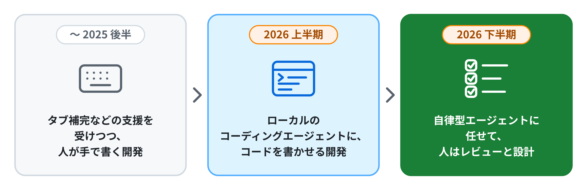
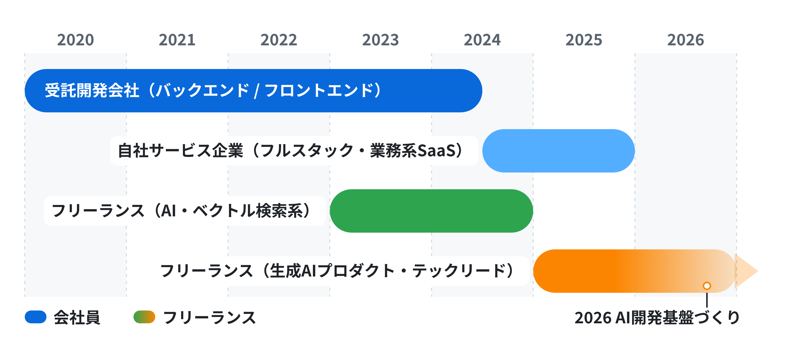

# fizzkazz

**バックエンド寄りフルスタック / テックリード / フリーランス** 
現在は、AIを活用したチーム開発の基盤づくりに取り組んでいます

---

## 概要

- Webアプリケーション開発に5年以上携わり、要件整理から設計・実装・テストまで一通り経験しています
- 現在はテックリードとして、チームの**AI開発基盤づくり**を主導しています
- 3〜30名規模のチームで開発に携わり、顧客や協力会社との調整も担当しています

---

## 直近の取り組み（2026年）

AIを個人での利用にとどめず、**チーム全体の開発の進め方**として定着させることに取り組んでいます。

<table>
  <thead>
    <tr>
      <th width="16%" align="left">時期</th>
      <th width="30%" align="left">テーマ</th>
      <th width="54%" align="left">取り組み内容</th>
    </tr>
  </thead>
  <tbody>
    <tr>
      <td><b>2026&nbsp;上半期</b></td>
      <td>コーディングエージェント × チーム開発</td>
      <td>Claude Code を軸にしたチーム開発の体制づくり。ルールやガードレール、開発フローを整える「<b>ハーネスエンジニアリング</b>」を推進</td>
    </tr>
    <tr>
      <td><b>2026&nbsp;下半期</b></td>
      <td>自律型AIエージェント 中心の開発</td>
      <td>Devin などの自律型エージェントにタスクを任せることを前提に、開発の基盤（環境・ワークフロー・レビュー体制）を整備</td>
    </tr>
  </tbody>
</table>

<picture>
  <source media="(prefers-color-scheme: dark)" srcset="./images/ai-flow-dark.png">
  
</picture>

---

## 経歴

<picture>
  <source media="(prefers-color-scheme: dark)" srcset="./images/career-timeline-dark.png">
  
</picture>

<table>
  <thead>
    <tr>
      <th width="17%" align="left">期間</th>
      <th width="23%" align="left">所属・形態</th>
      <th width="27%" align="left">役割</th>
      <th width="33%" align="left">主な担当</th>
    </tr>
  </thead>
  <tbody>
    <tr>
      <td><b>2025〜現在</b></td>
      <td>フリーランス</td>
      <td>テックリード フルスタックエンジニア</td>
      <td>設計・実装、技術的な意思決定、AI開発基盤の整備</td>
    </tr>
    <tr>
      <td><b>2024〜2025</b></td>
      <td>自社サービス企業</td>
      <td>フルスタックエンジニア</td>
      <td>要件定義・実装・テスト</td>
    </tr>
    <tr>
      <td><b>2023〜2024</b></td>
      <td>フリーランス （会社員と並行）</td>
      <td>フルスタックエンジニア</td>
      <td>要件定義・設計・実装</td>
    </tr>
    <tr>
      <td><b>2020〜2024</b></td>
      <td>受託開発会社</td>
      <td>バックエンドエンジニア フロントエンドエンジニア</td>
      <td>要件定義・設計・実装、顧客との折衝</td>
    </tr>
  </tbody>
</table>

---

## 得意領域

| 領域 | 内容 |
| :-- | :-- |
| **Webアプリケーション設計・開発** | 要件整理から設計・実装まで |
| **テックリード** | 技術選定、設計方針の整理、技術的な意思決定 |
| **AI開発基盤づくり** | コーディングエージェント / 自律型エージェントを使ったチーム開発の仕組み化 |
| **品質改善** | リファクタリング、ユニットテスト、E2Eテスト |
| **折衝・調整** | 顧客との折衝、協力会社との調整、スクラム運用 |

---

## 技術スタック

**Languages**

**Backend**

**Frontend**

**Database**

**Cloud**

**AI / Tools**

---

## 連絡先

- kzkngur@gmail.com
- [github.com/fizzkazz](https://github.com/fizzkazz)

最終更新: 2026/11
